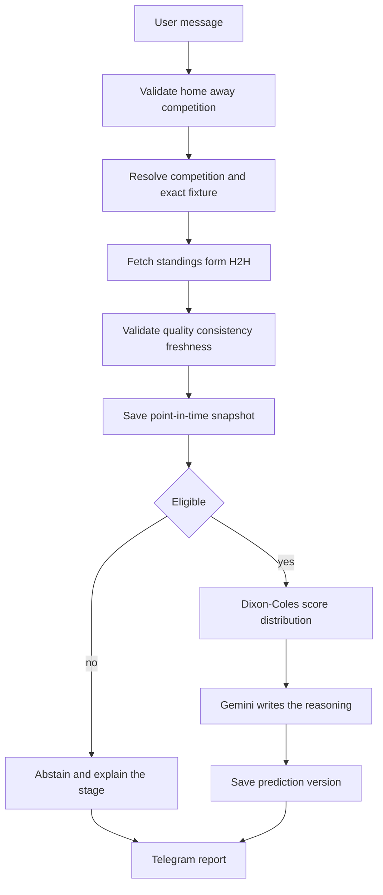
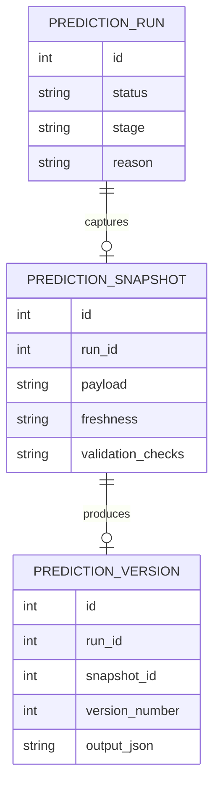

# Architecture

The bot answers Telegram commands on demand. Analysis starts only when the user asks for a prediction. `/today` lists fixtures without predicting them. There is no periodic scan and no background prediction job.

## Commands

```text
/today
/matches 24-05-2026
/predict Arsenal vs Chelsea | Premier League
/predict #560638
```

`/today` and `/matches DD-MM-YYYY` load fixtures for Premier League (`PL`), UEFA Champions League (`CL`), Primera Division (`PD`), Serie A (`SA`), Bundesliga (`BL1`), and Ligue 1 (`FL1`). Days and kickoff times use Africa/Cairo. `/matches` treats `DD-MM-YYYY` as a Cairo calendar day, requests the overlapping UTC date window, then keeps fixtures that kick off on that Cairo day. Each line shows the Football-Data.org match id, and each match also gets an inline button (`callback_data` `p:<id>`) that starts the same analysis as `/predict <id>`. The list text itself does not call Gemini; the button tap does.

Empty home, away, or competition text is rejected before any provider call. The same club on both sides is rejected the same way. Names may contain spaces. `vs` splits the clubs. `|` splits the competition. A bare numeric body is treated as a match id from `/today`.

Competition labels resolve only to the free tier: FIFA World Cup (`WC`), UEFA Champions League (`CL`), European Championship (`EC`), Premier League (`PL`), Championship (`ELC`), Bundesliga (`BL1`), Serie A (`SA`), Primera Division (`PD`), Ligue 1 (`FL1`), Primeira Liga (`PPL`), Eredivisie (`DED`), and Campeonato Brasileiro Série A (`BSA`). An unknown name returns that list. `Serie A` is the Italian league. The Brazilian league is requested by its own name or code.

Inside the named competition, a club resolves by its name, short name, three-letter code, or a known alias such as `Man City`, `Barca`, or `Inter`. A typo returns the closest names from that competition. An ambiguous name asks for a more specific one. Home and away are never swapped to force a hit.

## Workflow



`/predict` acknowledges the request, then awaits this path. The await covers only the match in that message. `/predict <id>` loads `GET /v4/matches/{id}` and continues from that fixture when the competition is one of the `/today` leagues.

### Identify

For a named command, teams are loaded for the one competition. The fixture search is `GET /v4/teams/{homeId}/matches` filtered to that competition, that opponent, and a home venue.

- The earliest `SCHEDULED` or `TIMED` fixture is the one that can be predicted.
- If the only meeting is the opposite venue, the reply names that fixture and stops.
- A `FINISHED` match reports the recorded score and stops. A match that has already been played is not predicted.
- `IN_PLAY`, `PAUSED`, `POSTPONED`, `SUSPENDED`, and `CANCELLED` stop with that status. They are not treated as a future match.
- If nothing matches, the reply says the competition and both clubs were checked.

### Retrieve

Only after that fixture is identified:

- `GET /v4/competitions/{code}/standings` for position, points, goals for, goals against, and goal difference.
- `GET /v4/teams/{id}/matches?status=FINISHED&limit=30` for each club. The analysis window is the latest five with a full-time score.
- Head-to-head meetings are taken from that history. If none are there, one `GET /v4/matches/{id}/head2head?limit=5` is used.

Code, not the model, computes last-five W-D-L, half-time goals scored and conceded, and second-half goals (`full time` minus `half time`) when both scores exist and the half-time score does not exceed the full-time score. The same finished matches feed the Dixon-Coles score in `score_model.py`.

Football-Data is called with `X-Auth-Token`. The client keeps about 8 calls per minute in process. HTTP 429 waits once for this request and then stops. HTTP 401 or 403 names the rejected key or competition. Team and standings bodies are cached on disk only while a request reads or writes them. There is no refresh loop.

### Validate

Every check is kept as pass, fail, or limitation.

| Check | What it requires |
| --- | --- |
| Consistency | Fixture home, away, and competition match the request, and both clubs appear in that standings table. |
| Availability | Each club has a standings row with goals and points, and the matches used have full-time scores. |
| Quality | Missing scores and missing table numbers stay missing. They are not written as zero. |
| Freshness | Each payload's `lastUpdated` is stored. A missing timestamp is freshness unknown, not current. The free-tier delay is always a warning. |

### Snapshot

The snapshot is the only Gemini input, together with the score estimate stored on it: request labels, resolved ids, kickoff, raw standings rows, last five, head-to-head, derived facts, check results, limitations, and fetch time. The stored snapshot keeps half-time samples so the trace shows why that market was skipped. The prompt copy drops those fields when the market is ineligible. `derived.score_model` holds λ, the chosen scores, and the market probabilities.

### Predict or abstain

No score is requested when any of these are true:

- The competition, club, or fixture was not identified.
- Standings are missing for either club.
- Either club has fewer than 3 finished matches with a full-time score.
- The provider rejected the key, hit the free-tier limit after one wait, or could not be reached.
- Gemini returns invalid JSON twice, or reasoning that is empty.

These limitations still allow a full-time estimate, and they are printed:

- Fewer than 3 of the last 5 scored matches are in the named competition. Matches from other competitions are used and named.
- Half-time scores exist on fewer than 3 of either club's last 5. Half-time result and half-time score are left out of the prompt and the report.
- No head-to-head meetings were found.
- A required `lastUpdated` value is missing, so freshness is unknown.
- A venue has fewer than 3 scored matches in the named competition, so rates use other competitions, the season table, or the finished-match list.
- Season `playedGames` is missing. It is not treated as zero.
- The season table supplied the rates, so home λ is multiplied by 1.25 and away λ by 0.85.

The free-tier delay warning is printed on every report that used provider data. By itself it does not change a completed run into a partial one.

`score_model.py` prices the match before Gemini is called. Home and away rates prefer the club's matches at that venue in the named competition. Fewer than 3 falls back to other competitions, then to the season `TOTAL` row. A missing `playedGames` is not stored as zero; the rate uses the finished-match list.

- `λ_home = home_scored_per_game × away_conceded_per_game / league_goals_per_team_game`
- `λ_away = away_scored_per_game × home_conceded_per_game / league_goals_per_team_game`

`league_goals_per_team_game` is `sum(goalsFor) / sum(playedGames)` on the `TOTAL` table that contains the clubs. The season-row fallback multiplies `λ_home` by 1.25 and `λ_away` by 0.85.

An independent Poisson grid for goals 0 through 6 is adjusted with the Dixon-Coles low-score correction at `ρ = -0.13`, then renormalized. The published full-time score is the most likely cell. Ties break toward the lower total, then the lower home-goal count. When half-time is eligible, the same grid is priced at `λ × first-half share`. The share is that club's half-time goals divided by its full-time goals on the last five consistent samples. A club with no full-time goals in that sample uses 0.45. The half-time label is the winner of that score.

1X2, both teams to score, and over/under 2.5 are sums over the full-time grid, so they can disagree with the modal score. Confidence is that cell's probability, as an integer percent.

Gemini is `google-genai` with `gemini-3.5-flash` unless `GEMINI_MODEL` is set. A display name is normalized to an API id before the call. Transient 503/429 responses are retried with backoff, then fallback models from `GEMINI_FALLBACK_MODELS` are tried. The call asks for JSON, with thinking budget 0. The accepted object is:

```json
{
  "tactical_reasoning": "..."
}
```

The prompt includes λ, both scores, and the market probabilities, and tells the model not to invent a different score. Empty reasoning is retried once. Team A is the requested home club and Team B is the requested away club. Half-time is cited only when that market is eligible.

### Trace

SQLite at `DATABASE_PATH` (default `data/predictions.db`) stores three rows:

- **Prediction Run:** chat, user, raw home, away, and competition text, time, status `completed | partial | abstained | failed`, stage, and the user-facing reason. A run is inserted when the command is accepted and updated when the path stops. A crash before that update stays `failed`, not `completed`.
- **Prediction Snapshot:** one row once a fetch has produced data, including abstentions after a fetch. It holds the capture time, competition code, match id, team ids, kickoff, payload, freshness, and validation checks.
- **Prediction Version:** written only when a prediction was produced. It stores the model id, prompt version, schema version, output JSON, and limitations. A rejected first response is not stored. If the retry is the response that passes, it is version 2 of the same run.

### Reply

Success names the competition, fixture, kickoff, half-time score when it is eligible, full-time score, 1X2, BTTS, and over/under 2.5 with the probability of the chosen side, confidence for the scoreline, reasoning, limitations, warnings, and the run id. The half-time line is above the full-time line. The markets header says they come from the score distribution. The footer says the result is a statistical estimate, not a betting tip.

Failure names the stage (`input`, `competition`, `teams`, `fixture`, `standings`, `form`, `provider`, `model`) and the reason. A known cause is not replaced with a generic retry message. One failed update does not stop the process.

## Modules

Shared dataclasses live in `models.py`. The other modules are the request path:

| Module | Role |
| --- | --- |
| `config.py` | Required keys and optional model, log level, and database path. Import and startup do not call external APIs. |
| `data_fetcher.py` | Async Football-Data client, competition and club resolution, fixture orientation. |
| `eligibility.py` | Checks, derived facts, and the abstain or partial decision. |
| `score_model.py` | Venue rates, Dixon-Coles grid, modal scores, and market probabilities. |
| `predictor.py` | Prompt, Gemini reasoning, validation, and retry. |
| `storage.py` | Run, snapshot, and version tables. |
| `pipeline.py` | The single orchestration path. |
| `bot.py` | `/start`, `/today`, `/matches`, `/predict`, and the Markdown report. |
| `main.py` | Process entry. Long polling only. |

## Data relationships



A run can stop with no snapshot when the command or the competition name fails before a fetch. A snapshot can exist with no version when the path abstains or the model does not return a valid score. A version always points at the snapshot that was shown to the model.
