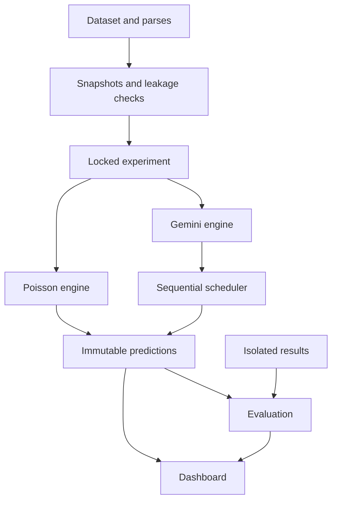

# BT-09 — Roadmap and Remaining Decisions

Status of this document: priority for the laboratory. It does not reclassify items in [the prediction roadmap](../prediction/05-mvp-scope-and-roadmap.md). A row marked closed in [BT-00](BT-00-decision-addendum.md) is a laboratory rule. A row marked open is still open.

The operator said to continue after checkpoint B. That authorizes checkpoint C below. It does not close D1–D10 and it does not change the Telegram bot.

## P0 — First laboratory

Required before a historical comparison is meaningful.

- A versioned historical dataset for one league named on the experiment, with raw payload and parsed match kept distinct.
- Pre-kickoff snapshots, leakage checks, and result isolation as in [BT-02](BT-02-temporal-reconstruction.md).
- Gemini as an independent structured predictor, web retrieval off, contamination limitation stored, as in [BT-04](BT-04-gemini-scheduling.md).
- Poisson comparison configuration as in [BT-03](BT-03-poisson-specification.md), including an explicit `k` on the experiment and a recorded tail tolerance.
- Sequential Gemini scheduling, pause, resume, stop, and visible quota waits.
- Immutable predictions and evaluations that attach beside them.
- The five markets, full distributions, and the metric card in [BT-05](BT-05-evaluation-metrics.md).
- Dashboard overall view, match list, and match detail, with engine-available and paired populations, as in [BT-07](BT-07-testing-dashboard.md).
- Experiment lock before pricing, as in [BT-08](BT-08-experiment-versioning.md).

The dashboard and the two-engine comparison are in this slice. Calibration charts and significance tests are not.

## P1 — Next laboratory increments

- Additional cutoffs that still use only information before that cutoff. Lineups stay out until the prediction roadmap allows them.
- The challenger list in BT-03, one change at a time: `k` grid, window, prior mean, joint strengths, Dixon-Coles, half-time share.
- Calibration plots from probabilities already stored.
- Filters and charts that split a metric by month.
- Prospective matches priced before kickoff, labeled separately from historical simulation.

## P2 — After the first comparison is stable

- Confidence intervals and a pre-declared test on paired metric differences.
- Stability by season and a report of exclusion bias.
- More than one league, each with its own averages. A pooled model is a new decision.
- By-club views.
- Lineup stage, only if the prediction baseline is amended to admit lineups.

## P3 — Outside the laboratory's comparison

- An ensemble of Gemini and Poisson.
- Installing either engine into the Telegram bot, or replacing the bot's current scorer.
- Odds, news, weather, and live match state.
- Automatic selection of a production model from a leaderboard.
- Background fixture monitoring.

## Dependencies

Poisson does not depend on the Gemini scheduler. The dashboard depends on stored predictions and, for scores, on evaluation. It does not depend on a job still running.

## Decisions still open

The operator named the first experiment in [BT-11](BT-11-experiment-exp-pl-001.md). The prediction register rows stay open. A locked setting is the value under test, not a finding.

1. **D8.** Named for EXP-PL-001: English Premier League (`PL`). The register row stays open until the data check in that register is done on the imported seasons.
2. **D1.** Declared for EXP-PL-001: `k = 6`. A later grid, including `k = 0`, is still required before 6 is treated as better than no shrinkage.
3. **D7.** Declared for EXP-PL-001: raw tail under 0.1% (`0.001`). The arithmetic check that the renormalized grid sums to 1 is still outstanding. It runs on the rates the experiment produces.
4. **Gemini schema and model.** `gemini-schema-exp-pl-001` and preferred model `gemini-3.5-flash` are locked in BT-11, confirmed from `.env`. Fallbacks are `gemini-3.8-flash` and `gemini-3.5-flash-lite`.
5. **D6.** EXP-PL-001 prices half-time from the start with `HT-SHARE-1`. Shares of 0.45 and 0.50 are not used. The register row stays open until half-time log loss is scored.
6. **D2, D3, D4, D5, D9, D10.** Unchanged. They stay on the comparison defaults. Challengers wait for P1.

Closing any of these in the prediction decision register still requires the evidence that register names. Locking an experiment is not that evidence.

## Implementation readiness

Checkpoint C is decided as follows. The bot process and `data/predictions.db` stay untouched.

- **Process.** A separate local Python package, `laboratory`, run with `python -m laboratory`. No cloud host.
- **Provider.** Football-Data.org, using `FOOTBALL_API_KEY` already present for the bot. Imports are explicit commands. The laboratory does not add a background fetch.
- **Store.** SQLite file `data/laboratory.db`, or `LAB_DATABASE_PATH` when set. Predictions are inserted once. The bot database path is not reused.
- **Dashboard.** Read-only pages on `127.0.0.1`. Opening a page does not call Gemini or rewrite a prediction.

D1 remains the experiment value `k = 6`, not a universal constant. Docs 01–06 are not amended. Gemini in the bot remains a commentator. Gemini in the laboratory remains an independent predictor.

## Checkpoints

- **Checkpoint A.** Accepted by the operator. BT-00 through BT-10 are the laboratory baseline. No code.
- **Checkpoint B.** Named in BT-11: English Premier League, `k = 6`, tail 0.1%, half-time estimator `HT-SHARE-1`, schema `gemini-schema-exp-pl-001`, model `gemini-3.5-flash`. These settings have not won a test.
- **Checkpoint C.** Decided: local `laboratory` package, Football-Data.org for explicit imports, SQLite at `data/laboratory.db`, read-only dashboard on localhost. The bot file `data/predictions.db` is not this store.
- **Checkpoint D.** A walk-forward result may close a D-row in the prediction register. The laboratory does not close that row by existing.
