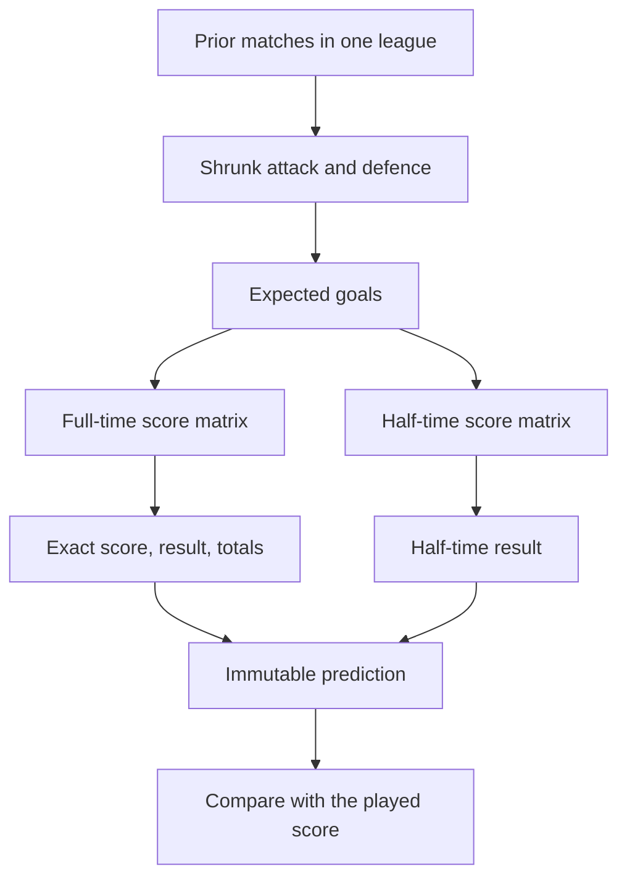

# MVP Prediction Philosophy

Status of this document: the prediction philosophy below is the documented baseline. Individual parameters listed in the [decision register](06-open-questions-and-decision-register.md) stay unapproved until a walk-forward comparison on one league accepts them. This document does not specify a database, an API, or a data provider.

The running score engine currently uses a Dixon-Coles grid with `ρ = -0.13`, a cutoff at 6 goals, a half-time share of 0.45, and home and away factors of 1.25 and 0.85 when the season table is the fallback. Those constants are implementation choices. They are candidates, not findings, and they are not part of this baseline.

## What the system is for

The system estimates how many goals each side is expected to score, turns those two rates into one score distribution, and reads every market off that distribution. It does not guess a score and then invent the other markets.

The sequence is:

1. Prior matches that were already played.
2. Team attack and defence, shrunk toward the league.
3. Expected goals, `λ_home` and `λ_away`.
4. A score probability distribution.
5. Market probabilities summed from that distribution.
6. A stored prediction that is later compared with the played score.

## Outputs

Required outputs, all from the same full-time grid unless noted:

- Ranked exact scores, including the mode and the next alternatives, each with a probability.
- The full-time result: home, draw, and away, as sums of cells.
- Half-time result: home, draw, and away. This uses a separate half-time rate, then the same distribution family.
- Over/under 2.5 and over/under 3.5.

A modal score of 1-1 can sit next to a home-win probability above the draw. The mode is one cell. The result is a sum of cells. Both are reported. The mode is not sold as the likely result.

Worked independent-Poisson example, goals 0 through 10, with assumed rates `λ_home = 1.5` and `λ_away = 1.1`. These rates are chosen to show the arithmetic. They are not a measured league.

- Most probable score: 1-1, about 12.3%.
- Result probabilities: home 46.4%, draw 25.8%, away 27.8%. They sum to 100%.
- The most probable score is a draw. The most probable result is a home win.

A second assumed pair, `λ_home = 1.5` and `λ_away = 0.9`, gives over 2.5 at about 43.0% and under 2.5 at about 57.0%. Over 3.5 is about 22.1% and under 3.5 is about 77.9%. Each pair sums to 100% on the normalized grid.

## Boundaries

The first engine is one league and one chronological history of final scores. One estimation step produces one full-time distribution and one half-time distribution. The half-time distribution is linked to the full-time rates by a scoring share. The explanation uses only those inputs.

Outside this engine:

- Player, lineup, injury, news, weather, and live match state.
- Odds, deep learning, and ensembles.
- Head-to-head as its own feature.
- Both teams to score as a required output. It is a free sum on the same grid, and showing it is an open product choice.

## Probability and reliability

A stated probability is the model's price for an outcome. It is not a promise, and it is not a measure of data quality.

Reliability is stated separately: how many prior matches support each rate, and how far shrinkage moved that rate toward the league. A short sample still produces expected goals, because shrinkage covers it. A missing half-time sample withholds the half-time market. A missing score is not filled with zero.

The phrase "confidence for this scoreline" in the current product is only the probability of the modal cell. In this design that number is labeled as the probability of that score. It is not a model-confidence score.

## Explanations

An explanation names the inputs that moved the rates. A valid sentence is: "The home attack ratio is 1.20, which raises `λ_home`." An invalid sentence is: "The home side will win because it is in form."

The explanation may restate scores that were already used. It does not treat a win-draw-loss record as a separate cause. It does not claim that a statistical association is a causal one.

## What this baseline assumes

- Goals are counts, so a Poisson mean is a usable expected-goal rate.
- The two sides can be treated as independent until a low-score correction beats that assumption on unseen matches.
- Home advantage is the gap between the league's home scoring average and its away scoring average. It is not a second fixed multiplier.
- Recent form is not a second multiplier on top of rates that already include those matches.
- No numerical result in this document is a measured performance of the model. The percentages above are arithmetic on assumed rates.
